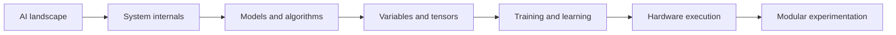
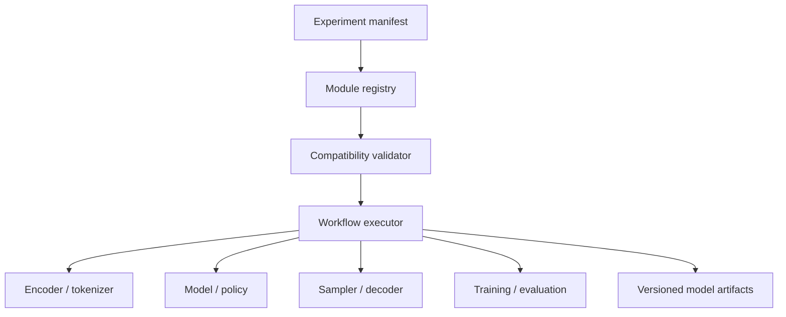

# Modular AI · Superior MI Labs

**[Explore the live visual website →](https://superior-mi-labs.github.io/Modular-AI/)** · [Visual lessons](https://superior-mi-labs.github.io/Modular-AI/learn.html) · [Diagram atlas](https://superior-mi-labs.github.io/Modular-AI/atlas.html) · [Architecture](https://superior-mi-labs.github.io/Modular-AI/architecture.html) · [Roadmap](https://superior-mi-labs.github.io/Modular-AI/roadmap.html)

> A visual learning atlas and architecture blueprint for a small-core, modular AI research framework. **Status: design and website only. No AI runtime, trained model, or model swapping implementation yet.**

## From entire systems to individual calculations



**20 diagrams** explain transformers, diffusion, decision systems, reinforcement learning, graph networks, state-space models, tokens, vectors, training gradients, hardware and modular design. Each diagram has one editable Mermaid source; the website publishes SVG exports and lets visitors search, filter, inspect and download sources.

## The intended modular kernel



The design favors **Ports and Adapters**, **Strategy**, and a **Registry/Factory** over an indiscriminate plugin system. A valid swap must preserve semantic port contracts, data layouts, and checkpoint dependencies. Changing a tokenizer or latent codec may require remapping weights or retraining the model.

## Explore the repository

| Area | Description |
|---|---|
| [`site/`](site/) | Lightweight multi-page learning website, no frontend package dependencies |
| [`diagrams/`](diagrams/) | 20 editable Mermaid sources, generated SVGs, structured diagram catalog |
| [`docs/`](docs/) | Architecture decisions, contracts, lifecycle, model families, tests and sources |
| [`examples/`](examples/) | Five illustrative experiment manifests: decision, text, image, video and VAD state |
| [`registry/`](registry/) + [`schemas/`](schemas/) | Conceptual module definitions and experiment validation schema |
| [`src/modular_ai/`](src/modular_ai/) | Explicit planned boundaries for the future execution framework |
| [`tools/`](tools/) + [`tests/`](tests/) | Diagram export, site publishing, and structural validation |

## Build and validate locally

Graphviz `dot` and Python 3 are required. On Linux Mint/Ubuntu, install Graphviz with `sudo apt install graphviz`.

```bash
python3 tests/validate_bundle.py
python3 -m unittest discover -s tests -p 'test_site.py'
python3 tools/build_site.py
python3 -m http.server 8000 --directory .site-dist
```

Open `http://localhost:8000/` to preview. Publishing uses one GitHub Actions workflow, scoped to website and architecture changes, and deploys the generated `.site-dist/` artifact to GitHub Pages.

## Development direction

1. **Baseline:** configuration/registry/typed-port validation plus a deterministic decision environment.
2. **First trainable model:** one neural reference pipeline with checkpoint and evaluation tests.
3. **Representation experiments:** custom tokens, state encodings, memory structures and explicit migration rules.
4. **Optimization:** precision, quantization, benchmarks, reproducibility and model artifact lineage.
5. **Expansion:** text, image, audio and video model families with their own control loops.

Start with the [roadmap](docs/06-roadmap.md) and [acceptance tests](docs/05-tests.md). The modular design should be proven by tests before it is generalized.

Contributions: [CONTRIBUTING.md](CONTRIBUTING.md). Sources and reading material: [docs/07-sources.md](docs/07-sources.md).
